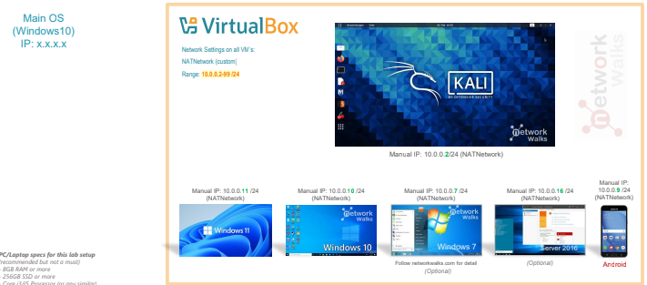
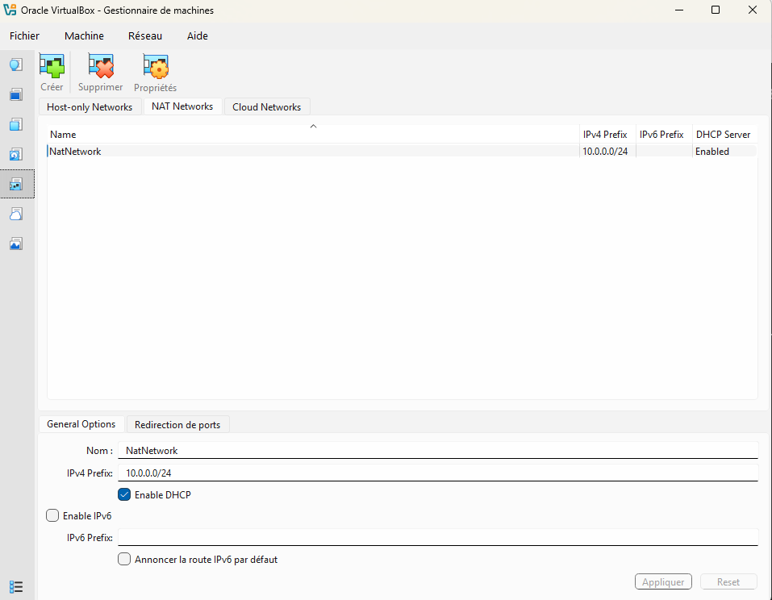
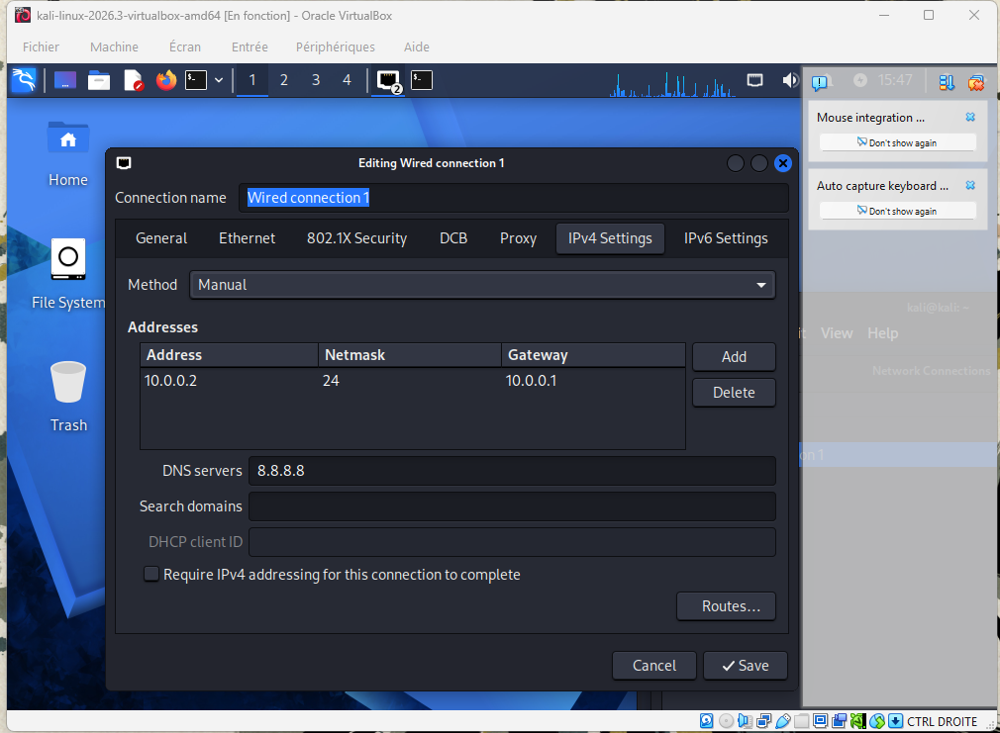

<div align="center">

# 🛡️ Cybersecurity Lab Environment Setup

**Building an isolated virtual lab for penetration testing and ethical hacking practice**
</div>

<p align="center">


</p>

---

## 📌 Project Overview

This project documents the step-by-step deployment and network configuration of an isolated virtual laboratory designed for penetration testing, vulnerability assessment, and security analysis. 

The lab is isolated within a private NAT Network (`10.0.0.0/24`) to allow controlled communication between testing machines and potential targets while preventing unauthorized external exposure.

---

## 🎯 Objectives

The main goals of this lab deployment are:
* Set up Oracle VM VirtualBox as the primary hypervisor.
* Import and configure **Kali Linux** as the primary security workstation.
* Create a custom **NAT Network** (`10.0.0.0/24`) for local machine intercommunication.
* Assign a persistent static IP address (`10.0.0.2`) to the Kali VM.
* Overcome interface initialization issues (e.g., DAD timeout in modern Kali/VirtualBox releases).
* Verify end-to-end network connectivity, gateway communication, and DNS resolution.
* Take a clean virtual machine snapshot for baseline restoration.

---

## 🛡️ Purpose of the Lab

This environment acts as an isolated sandbox built specifically for safe execution of security operations:
* Network reconnaissance and port scanning
* Vulnerability detection and security auditing
* Traffic sniffing and packet analysis
* Custom script testing and tool integration

> ⚠️ **Disclaimer:** This laboratory environment is created strictly for educational and authorized testing purposes. All actions are conducted within isolated virtual networks.

---

## ⚙️ Lab Specifications & Configuration Summary

| Component | Specification / Setting |
| :--- | :--- |
| **Hypervisor** | Oracle VM VirtualBox 7.x |
| **Primary OS** | Kali Linux |
| **Network Type** | NAT Network (`NatNetwork`) |
| **Subnet Range** | `10.0.0.0/24` |
| **Subnet Mask** | `255.255.255.0` |
| **Kali Static IP** | `10.0.0.2/24` |
| **Default Gateway** | `10.0.0.1` |
| **DNS Server** | `8.8.8.8` |
| **Allocated RAM** | 2048 MB |

---

## 🛠️ Lab Setup Procedure

### **Step 1: VirtualBox NAT Network Creation**
A dedicated NAT Network named `NatNetwork` was created in VirtualBox preferences using the `10.0.0.0/24` subnet. This enables internal communication across virtual guests while retaining outbound internet accessibility.

### **Step 2: Importing and Assigning Kali Linux**
* Downloaded the official Kali Linux VM image.
* Attached Network Adapter 1 to `NAT Network` with name `NatNetwork`.
* Allocated 2 GB of RAM and configured basic system settings.

### **Step 3: Static IP Configuration & Troubleshooting**
Assigned the static IP `10.0.0.2/24` on interface `eth0`. 

> **Technical Solution:** Handled NetworkManager / DAD restrictions by executing direct low-level commands in the terminal:
> ```bash
> sudo ip addr flush dev eth0
> sudo ip addr add 10.0.0.2/24 dev eth0
> sudo ip route add default via 10.0.0.1
> ```

### **Step 4: Clean Baseline Snapshot**
Created a VirtualBox snapshot named **`Clean Baseline - Network Setup`** immediately after IP verification to ensure quick recovery in case of future configuration changes.

---

## 🐞 Problems Encountered & Solutions

### **Problem 1: Interface Initialization & DAD Conflict**
* **Symptom:** Network interfaces under modern Kali Linux / VirtualBox v7 fail to apply manual configurations cleanly.
* **Resolution Path:** Bypassed NetworkManager constraints by directly flushing the interface and applying low-level `ip` routing commands:
  ```bash
  sudo ip addr flush dev eth0
  sudo ip addr add 10.0.0.2/24 dev eth0
  sudo ip route add default via 10.0.0.1
  ```

### **Problem 2: Hardware Virtualization (VT-x / AMD-V) Disabled**
* **Symptom:** The VM initially failed to start because hardware virtualization was disabled in the system firmware/BIOS.
* **Resolution Path:** Restarted the computer, entered BIOS/UEFI settings, enabled Intel VT-x / hardware virtualization, saved the configuration, and restarted the VM successfully.

---

## 📊 Lab Verification Matrix

| Test | Command | Expected Output | Status |
| :--- | :--- | :--- | :---: |
| **Check IP address** | `ip a` | Correct Kali IP (`10.0.0.2`) displayed | ✅ Pass |
| **Test gateway** | `ping -c 4 10.0.0.1` | Successful replies | ✅ Pass |
| **Test Internet connectivity** | `ping -c 4 8.8.8.8` | Successful replies | ✅ Pass |
| **Test DNS resolution** | `nslookup google.com` | Domain resolves | ✅ Pass |
| **Verify snapshot** | Restore snapshot & run `ip a` | Baseline configuration restored | ✅ Pass |

---

## 📸 Proof of Execution & Visual Evidence

### 1. Lab Architecture Blueprint


### 2. VirtualBox NAT Network Settings (`NatNetwork`)


### 3. Kali Linux IPv4 GUI Network Configuration


### 4. Terminal Interface & IP Verification (`ip a`)


---

## 💡 What I Learned

Through this project, I learned how to create and configure a virtual environment for cybersecurity practice. The most important concepts include:
1. **NAT vs NAT Network:** Understanding how a NAT Network allows multiple VMs to communicate with one another while providing outbound routing.
2. **Virtual Machine Networking:** Configuring virtual network adapters to connect virtual machines properly.
3. **Static IP Configuration:** Managing IPv4 addressing, subnet masks, gateways, and DNS settings.
4. **VM Snapshots:** Creating a known-good recovery point before performing experimental activities.
5. **Documentation:** Documenting commands, configurations, problems, and solutions professionally.

---

## 🔗 Tools & Resources

* **7-Zip:** [https://7-zip.org/download.html](https://7-zip.org/download.html)
* **VirtualBox:** [https://virtualbox.org/wiki/Downloads](https://virtualbox.org/wiki/Downloads)
* **Kali Linux:** [https://kali.org/get-kali](https://kali.org/get-kali)

---

## 👤 Author

**Malek Aroua**  
*Computer Networks Graduate | Cybersecurity Specialist*  

---
*Project completed as part of the NetworkWalks Cybersecurity Certification Program.*
